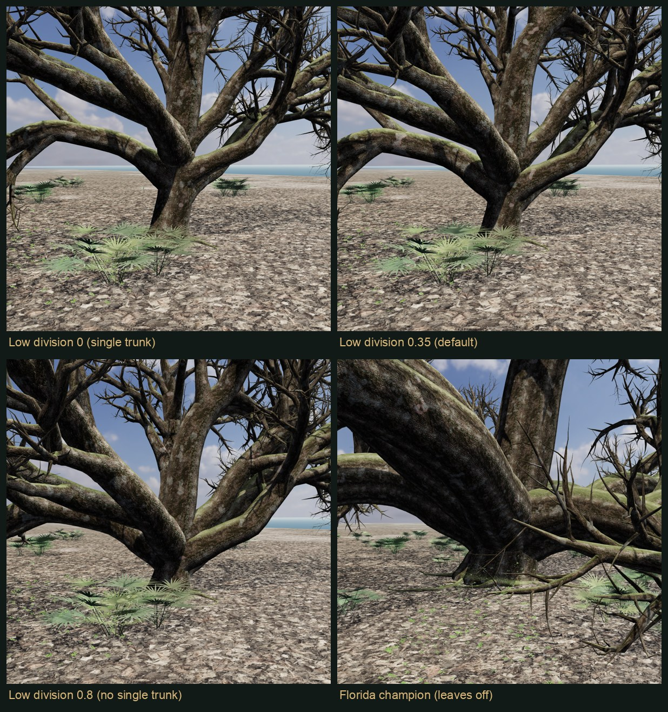
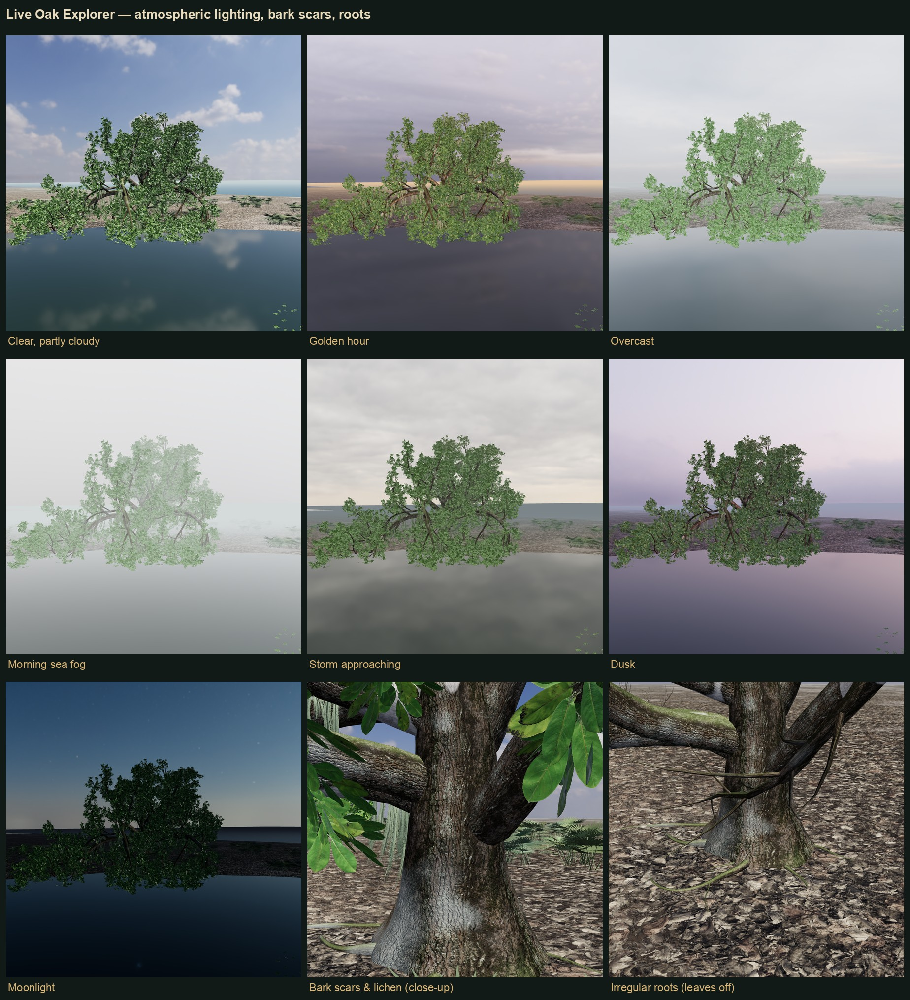

# Live Oak Explorer

*Crafted by Paul Fishwick & Claude Code*

An interactive explorer for a single **coastal live oak** (*Quercus virginiana*) as it grows on
Amelia Island, Florida. It models **salt pruning** driven by a user-set wind vector, wind
training over the tree's lifetime, wind-axis root buttressing, low branching, Spanish moss and the
maritime-hammock understory.

The same tree can be shown in three renderers:

| Renderer | What it gives you | Speed |
|---|---|---|
| **Three.js** (browser) | Live growth and every slider in real time, using photoscanned bark and leaf textures | 30–60 fps |
| **Blender 5.1** (Cycles or EEVEE) | Path-traced stills with 4K bark, hair-strand Spanish moss, and GLB, FBX and .blend export | ~10–60 s per still on CPU |
| **Unreal Engine 5.8** | A Lumen-lit level with foliage wind and a matching camera, left open for exploring | First launch compiles shaders (minutes) |

## Run

```bash
cd /Users/paul/code/ameliaisland/oak
node server.js            # no npm install needed
open http://localhost:8420
```

The Three.js explorer also works from any static server. The **Blender + Unreal** tab needs
`server.js`, which finds Blender at `/Applications/Blender.app` and Unreal under
`/Volumes/*/UnrealEngine/UE_*` or `/Users/Shared/Epic Games/UE_*`. You can override these with
`BLENDER_PATH`, `UE_ROOT` and `PORT`.

## GitHub Pages

The Three.js explorer is a static site (`index.html`, `css/`, `js/`, `vendor/`, `assets/`,
`photos/`, `meshy/meshy_oak_web.glb`), so GitHub Pages can host it as-is. Turn on Pages for the
repository root on the `main` branch.

Blender and Unreal can't run on Pages, because they need `server.js` driving locally installed
applications. On the hosted page, the **Blender + Unreal** tab simply shows how to start the local
server. Everything else works.

The repository contains only the web app. These stay local:
- `server.js`, `blender/`, `unreal/` and `tools/`;
- the 4K textures;
- the original 178 MB Meshy model;
- `output/`.

## How it works

The central idea is a **skeleton**: a graph of joints (position and radius) and the connections
between them. Like a human skeleton, it describes structure only. Every renderer then adds its own
"flesh" on top of it.

```
js/oakGenerator.js   grows the skeleton (branches, leaves, moss strands, roots) from the sliders
js/oakMesher.js      skeleton -> three.js tubes, leaf sprigs, moss ribbons
blender/build_oak.py skeleton -> denser tubes, GN-instanced sprigs, hair-curve moss, Cycles, GLB/FBX
unreal/scripts/      Blender FBX -> UE5 materials + Lumen level (+ screenshots)
```

Turn on **Skeleton view** under *Limbs & branching* to see the bare graph.

### Salt pruning and wind
- **Wind from** (the compass dial) and **Wind strength** set the wind vector. The default is from
  the east, the Atlantic side of Amelia Island.
- **Shear surface**: an inclined dome that rises leeward at the **Crown shear angle**.
  - Thin shoots that grow through it die back. That sprouts dense tufts just below the surface, so
    the crown edge looks clipped like a hedge. It also leaves dead grey stubs and salt-burned
    leaves.
  - **Thick limbs never die at the surface.** They flatten out and grow under it, because salt
    kills buds, not old wood.
  - **Show shear surface** draws it.
- **Over time** (**Age**, **Grow time-lapse**) several effects accumulate:
  - the trunk curves leeward;
  - young wood is trained downwind;
  - windward branches are stunted (**flagging**);
  - roots and the trunk base thicken along the wind axis (**Wind buttressing**). Use **X-ray root
    plate** to see them below ground.
- **Visualise salt aerosol** is off by default, because real salt spray is invisible. When on, it
  is a faint overlay showing the wind path.

### Live oak form, checked against photos
The model was tuned against the field photos in `photos/` and about 160 openly licensed reference
photos in `photos/web/` (credits in `photos/web/CREDITS.md`). The main traits it reproduces:
- a short, massive trunk that divides low into 5–10 thick, slowly tapering limbs, with a fork at
  the trunk top rather than a cut-off leader;
- near-horizontal limbs that undulate, sag until an elbow rests on the ground, then turn up again;
- crooked, zig-zag (sympodial) branching;
- foliage forming a roof over bare inner limbs, which the model handles as interior shading.

In the app, open **Reference photos** and pin any photo beside the viewer to compare while you
adjust sliders. Photos showing houses, streets, poles, cars or fences were removed so the
references show trees only.

When run locally, the gallery also includes a **Live Oak Society** tab: 30 photos from Coleen
Perilloux Landry's PBase gallery
([pbase.com/septembermorn/the_live_oak_tree](https://pbase.com/septembermorn/the_live_oak_tree)).
They are copyrighted, kept on this machine as reference only (`photos/pbase-reference/`, which git
ignores), and are never published to GitHub Pages.

### Low limbs, water and canopy fullness
- **Low limb clearance** (m) sets how high the lowest limbs stay. At 0, heavy limbs can rest an
  elbow on the ground.
- **Retention pond beside tree** (with **Pond direction**) adds an irregular pond. Open water is a
  light gap, so limbs swing toward it, grow longer, droop, and can dip into the water. The
  **Live oaks by a retention pond** preset shows this.
- **Canopy fullness** runs from an open, airy crown to the closed foliage shell of a mature live
  oak. It scales twig ramification, sprigs per twig and leaf size together.

### Growing toward the light
**Light seeking** bends shoots toward the tree's light field (`lightField()` in
`js/oakGenerator.js`) and lets leaves survive better on the bright side. The field combines:
- skylight from above;
- the southern sun path at 30.6°N;
- over a pond, open sky plus reflected light from the water.

The pond behaviour comes out of the same rule. Measured on the pond preset:

| Light seeking | Pond-side reach | Branches touching water |
|---|---|---|
| 0 | 13.7 m | 31 |
| 0.5 | 21.8 m | 163 |

On the sheltered tree, south-side leaves grow from 51% to 59% as Light seeking goes from 0 to 1.

### Trunk form
Large live oaks don't have a tapering, cone-shaped base. The trunk is close to a cylinder with a
short root collar where the roots meet it. Often it divides near the ground into several massive,
trunk-sized limbs, with no obvious single trunk.
- **Low division** sets how close to the ground that split happens and how massive the first limbs
  are.
- **Root collar** sets the short swelling at the very base.
- **Show leaves** and **Show Spanish moss** (under *Foliage*) hide those layers to show the
  structure. Blender and Unreal follow these toggles.



### Atmosphere, bark and roots
- **Atmosphere** (under *Environment*) offers seven skies: clear, golden hour, overcast, morning
  sea fog, storm approaching, dusk and moonlight.
  - Each sets the CC0 pure-sky HDRI, sun strength and colour, haze and exposure. Golden hour, dusk,
    sea fog and moonlight also move the sun.
  - They are defined once in `assets/atmospheres.json`, which three.js, Blender and Unreal all
    read.
  - Leaf translucency now scales with sunlight, so leaves don't glow under overcast or night skies.
- **Scars & splits** (under *Bark*) adds narrow, slightly darker splits running along each branch,
  with gentle tone variation and damp streaks. **Lichens** adds soft grey-green crustose blotches
  and, occasionally, Christmas lichen with its muted red rim (see
  [docs/florida-champion.md](docs/florida-champion.md)).
- **Florida champion (Alachua)** is a preset matched to the 2023 state champion live oak: 11.1 m
  trunk circumference, about 24 m tall, 55 m spread, and long limbs bowing to the ground. Its dome
  shape comes from growth alone, with no salt.
- **Roots** are irregular in count, spacing, thickness and length. They taper quickly near the
  trunk, snake and hump along the surface, and occasionally fork.
- **Spanish moss** sways more than the foliage, with a light flutter, because it weighs almost
  nothing.
- **The retention pond** is on by default.



### Spanish moss and understory
- **Spanish moss** (*Tillandsia usneoides*) hangs from sheltered, near-horizontal limbs and avoids
  the salt-blasted windward face.
- **The ground** follows the maritime-hammock community:
  - oak leaf litter on sandy soil, concentrated under the canopy;
  - saw palmetto colonies;
  - yaupon and wax myrtle shrubs;
  - wood-oats grass, or sea oats on the dune setting.

## Keeping the three renderers consistent
- **The tree:** every renderer builds from the same skeleton JSON, with the same leaf-sprig
  layout, atlas rectangles, trunk-flare formula and pond outline.
- **The ground:** `assets/grounds.json` is the single definition of each ground type: textures,
  tint, evergreen tan desaturation, noise blend and litter under the canopy. `js/materials.js`,
  `blender/build_oak.py` and the Unreal script all read it and apply the same formula.
- **Lighting:** Blender's sun and sky strength, and Unreal's pinned exposure, are matched to the
  Three.js scene.
- **Unreal materials:** these are **master materials** compiled once (`/Game/Oak/Masters`, with
  the version in the name) plus per-run **material instances**. After the first launch, runs don't
  recompile shaders or ray-tracing pipelines.
- **Vertex colours:** palmetto and grass colours, and leaf salt-burn, travel to Unreal
  sRGB-encoded so 8-bit colours keep enough precision. The Unreal materials decode them.
- **Unreal lighting:** Lumen uses **hardware ray tracing** (Apple M3/M4 Metal RT), with mesh
  distance fields as the fallback (`unreal/OakExplorer/Config/DefaultEngine.ini`).

`output/crosscheck/crosscheck.jpg` puts model views next to the field and reference photos, and
compares the same scenes across the three renderers.

## Textures and assets (CC0)
- **Bark:** Poly Haven *Jolcham Oak Bark 01*, *Tree Bark 03*, *Bark Brown 02* (2K and 4K PBR).
- **Leaves:** ambientCG *LeafSet022* (smooth elliptic leaves, matching live oak).
- **Ground:** Poly Haven *Leaves Forest Ground*, *Forest Leaves 02*, *Forrest Sand 01*,
  *Coast Sand 01*.
- **Sky:** Poly Haven HDRI *Kloofendal 48d Partly Cloudy*.
- **Meshy model:** `meshy/meshy_oak_web.glb`, the Meshy "Whispering Oak" decimated from 7.4M to
  250k triangles with `tools/decimate_meshy.py`. It is geometry only and not parametric, so it is
  shown just as a visual reference.

## Software reviewed
- [ez-tree](https://github.com/dgreenheck/ez-tree) (MIT, Three.js). Its split between skeleton and
  mesh, its force tropism and its leaf-sway shader shaped `oakGenerator.js`.
- [PD: Tree Generator](https://drajmarsh.bitbucket.io/tree3d.html). Proctree-based, with radial and
  forking branches and solar shading.
- [Tripo3D: Best Procedural Tree Generators 2026](https://www.tripo3d.ai/blog/best-procedural-tree-generators).
  The page blocks automated fetching, so it was not reviewed.

## Notes
- The first Unreal launch after a material change compiles the masters, plus ray-tracing pipelines
  (it may briefly show "Ray Tracing PSO is not ready yet, using fallback"). Later launches reuse
  them.
- Cycles defaults to **CPU**. GPU (Metal) rendering is offered as experimental, because its kernel
  compilation hung in background mode on this machine (Blender 5.1.1).
- Outputs from each run are written to `output/jobs/<id>/`: `render.png`, `oak.glb`, `oak.fbx`,
  `oak.blend` and Unreal screenshots.
- The Unreal project is `unreal/OakExplorer/`. Its `Content/Python/init_unreal.py` builds the scene
  only when the server launches the editor.

## License

MIT, see [LICENSE](LICENSE). Third-party textures, photos and three.js keep their own licences, listed in [NOTICE](NOTICE).
