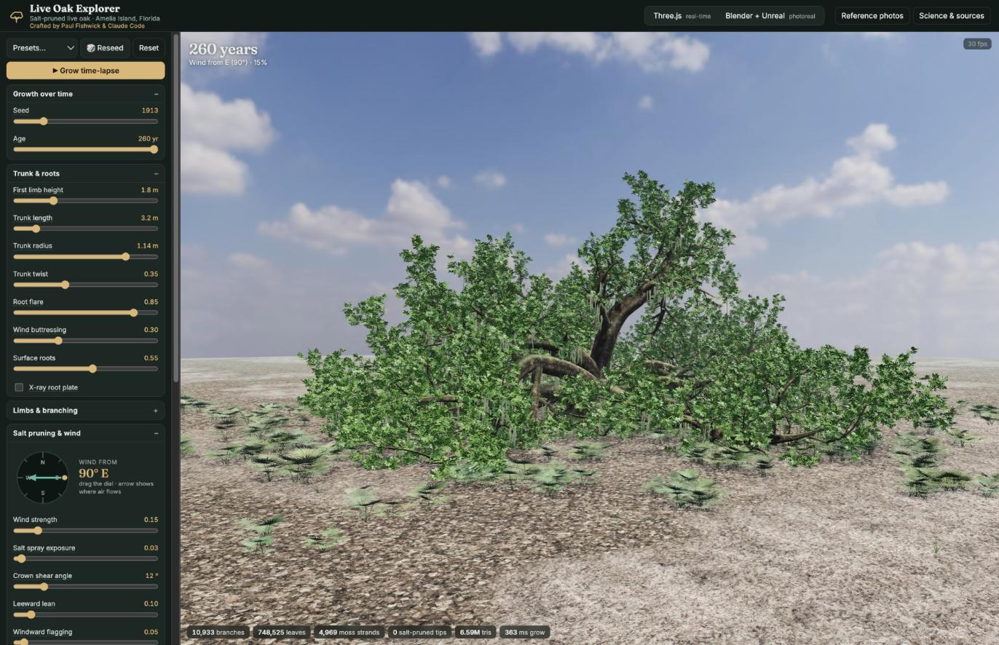
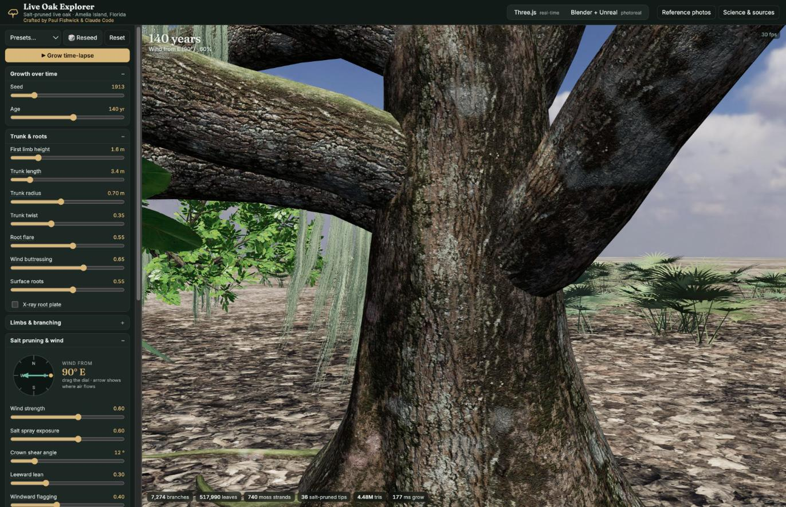

# Florida champion live oak (Alachua) as a benchmark

In October 2023 a southern live oak near San Felasco Hammock Preserve State Park in Alachua became
Florida's state champion. WUFT reported these measurements
([article](https://www.wuft.org/human-interest/2023-10-04/floridas-champion-live-oak-tree-stands-tall-a-new-statewide-record-holder-in-alachua)):

| | Champion | Explorer preset "Florida champion (Alachua)" |
|---|---|---|
| Trunk circumference | 36.5 ft (11.1 m) | 11.1 m |
| Height | 78 ft (24 m) | 22 m |
| Crown spread | 180 ft (55 m) | 55.6 m |
| Age | 200–300 years | 260 years |
| Major limbs | 12, all reaching the ground and curving back up | 12, of which 8 reach the ground |

The article also notes a long, healed lightning scar on the north side of the trunk, and Spanish
moss and lichen on the limbs and trunk.

## Dome versus salt ramp

The champion is not salt pruned and grows in little wind, yet its outline is a smooth dome. That
is the natural form of an open-grown live oak. With full light on every side, each limb grows out
toward open sky, then arches down under its own weight. Branch tips across the crown end up at a
similar distance from the trunk, which gives the hemisphere.

A salt-pruned coastal oak is different. It forms a lopsided ramp, low on the sea side and rising
leeward, because the shear surface clips one side.

In the explorer the champion's dome emerges from growth alone: arching, sagging limbs plus light
seeking, with salt essentially off. To make it possible, very long, near-horizontal main limbs now
bow under their own length when **Low limb clearance** is near 0. Default trees keep their limbs
lifted, so they are unaffected.

## Bark: splits and lichens

The bark model follows a reference photo of a real oak trunk:
- Scars are narrow, slightly darker splits that run along each branch, with a faintly darker
  lifted edge. They are low contrast, not pale patches.
- Crustose lichens form soft grey-green blotches, tinted relative to the bark so they read as
  mottling.
- Here and there, Christmas lichen (*Cryptothecia rubrocincta*) appears as a pale crust with a
  muted red rim. This Florida species has been recorded on live oak branches and on oak bark in
  Florida.

