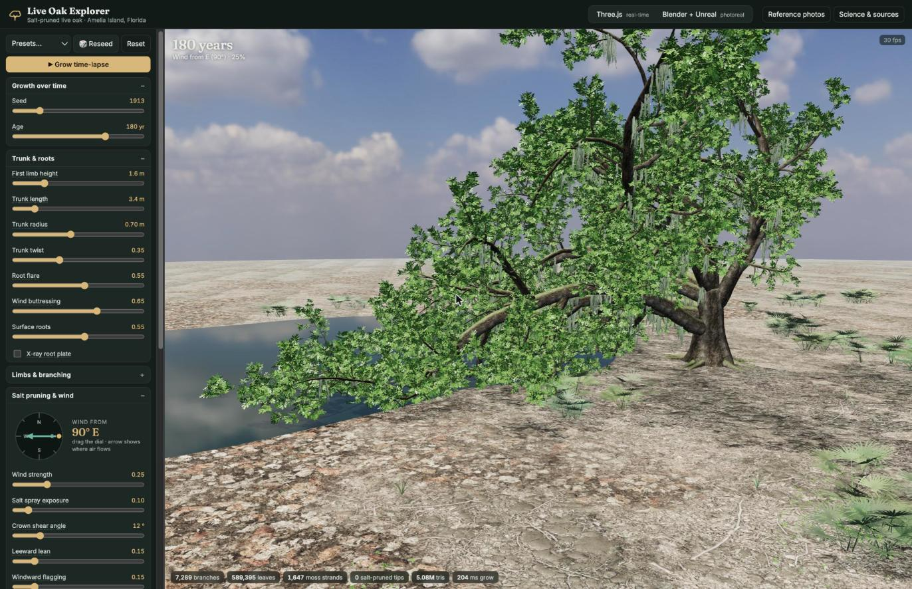
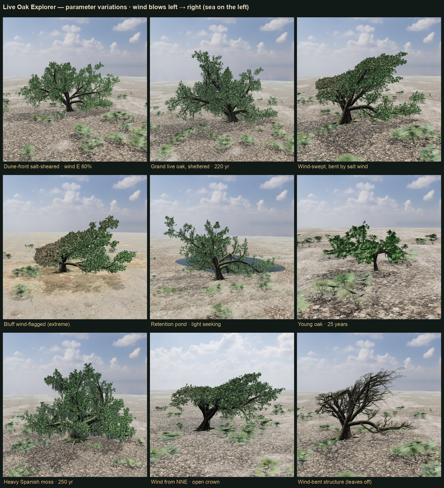

# Growing toward the light

*Notes from the Live Oak Explorer design discussion, 25 October 2026.*

## Do low limbs dip into the water to "drink"?

No. Trees take up water through their roots, mostly fine roots in the top few feet of soil. Bark
and branches absorb essentially nothing. A submerged limb gets no oxygen and invites rot, so it is
a liability rather than a straw.

Low limbs reach the water for three reasons:

1. **Light.** Open water is a permanent gap in the canopy and the brightest direction the tree
   has, so limbs over the pond grow longer.
2. **Weight over time.** Long, heavy, near-horizontal live oak limbs sag as they lengthen. Over
   land something stops them; over water nothing does, so the tips droop to the surface.
3. **No shading.** Low shoots inside a crown normally die from shade, but over water they stay lit
   and keep their leaves.

The anthropomorphism does hold in two places:
- The **roots** grow toward moisture (hydrotropism). An oak beside a retention pond almost
  certainly has a dense root mat heading toward the shore.
- **Spanish moss** really does drink from the air. Scales on its strands absorb rain, fog and
  humidity directly.

## The tree grows toward its light field

A tree grows toward the sum of all the light reaching it, not just "up":

- **Diffuse skylight** from the open dome above drives upward and outward growth.
- **The sun's path.** At Amelia Island (about 30.6°N) the sun crosses the southern sky, so
  open-grown crowns tend to be fuller and longer on the south side.
- **Light over water.** A limb over a pond sees a much larger patch of open sky. It also receives
  light reflected off the surface, which is weak at noon but strong at low sun angles (morning,
  evening, winter) and lights the limb from the side and from below.

This happens in two ways at once: shoots bend toward brighter directions as they grow
(phototropism), and shoots in bright positions thrive while shaded ones die back. Over decades the
whole crown flows toward the light.

## How the app models it

The **Light seeking** slider (under *Limbs & branching*) uses `lightField()` in
`js/oakGenerator.js`:
- Each growing shoot bends toward the light vector: skylight from above, plus the southern sun
  direction, plus pull toward and up from open water. The water term fades with distance from the
  shore.
- Leaves in brighter positions survive the interior-shading cull more often.

Because Blender and Unreal build from the same skeleton, the effect appears in all three
renderers.

Measured in the browser:

| Tree | Light seeking | Result |
|---|---|---|
| Sheltered grand oak | 0 → 1 | South-side leaves go from 51% to 59% of the canopy |
| Retention pond | 0 | Pond-side reach 13.7 m, 31 branches touching water |
| Retention pond | 0.5 (default) | Reach 21.8 m, 163 branches touching water |
| Retention pond | 1 | Reach 23.3 m, 174 branches touching water |

## Parameter variations

Nine trees, each viewed side-on to the wind (wind blows left → right):

